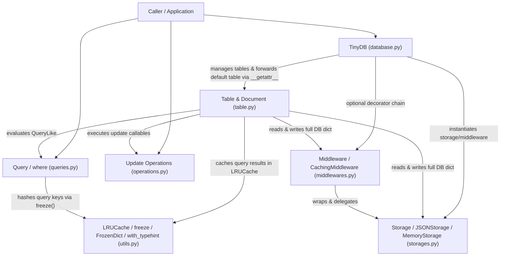

# TinyDB Architecture (`edff96a`)

> Verified against `msiemens/tinydb` at pinned commit `edff96a` (v4.9.0, Python `>=3.10,<4`, zero third-party runtime dependencies).

---

## 1. Component Overview

TinyDB is a lightweight, pure-Python document-oriented database structured into seven focused modules under `tinydb/`. All persistent state is modeled as a nested Python dictionary `{table_name: {str(doc_id): document_dict}}`.

### Core Components

| Module | Primary Symbols | Responsibility & Interactions |
|---|---|---|
| `tinydb/database.py` | `TinyDB` | Entry point. Instantiates the configured `Storage` (or `Middleware` chain), manages named `Table` instances in `self._tables`, and forwards unknown method/attribute calls to the `_default` table via `__getattr__`. |
| `tinydb/table.py` | `Table`, `Document` | Central CRUD engine (`insert`, `insert_multiple`, `search`, `get`, `contains`, `update`, `update_multiple`, `upsert`, `remove`, `truncate`, `count`). Holds an `LRUCache` (`self._query_cache`) invalidated on every write via `_update_table()`. |
| `tinydb/queries.py` | `Query`, `QueryInstance`, `QueryLike`, `where` | Fluent query builder and callable predicate protocol. `Query` records a field path (`self._path`) and builds hashable `QueryInstance` objects that `Table.search()` evaluates and caches. |
| `tinydb/storages.py` | `Storage`, `JSONStorage`, `MemoryStorage`, `touch` | Abstract persistence boundary (`read`, `write`, `close`). Reads/writes the entire database dict atomically (`None` signals an empty/uninitialized store). |
| `tinydb/middlewares.py` | `Middleware`, `CachingMiddleware` | Transparent decorator chain around `Storage` classes. Uses `__call__` to mimic a `Storage` constructor when passed as `TinyDB(storage=CachingMiddleware(JSONStorage))`. |
| `tinydb/operations.py` | `delete`, `add`, `subtract`, `set`, `increment`, `decrement` | Stateless factory functions returning `Callable[[MutableMapping], None]` transforms for `Table.update(...)`. |
| `tinydb/utils.py` | `LRUCache`, `FrozenDict`, `freeze`, `with_typehint` | Pure utility layer: bounded `OrderedDict`-based LRU cache for `Table`, immutable hashing helpers (`freeze`, `FrozenDict`) for `QueryInstance` cache keys, and typing helper for `TinyDB(with_typehint(Table))`. |

---

## 2. Key Architecture Decisions in TinyDB

### TinyDB-ADR-1: Full-Database Read-Modify-Write via Abstract `Storage`
- **Status:** Verified (`tinydb/storages.py:36-76`, `tinydb/table.py:804-854`)
- **Context:** TinyDB targets small embedded datasets and multiple pluggable backends (JSON files, in-memory dicts, custom user storages) with minimal code complexity and zero external dependencies.
- **Decision:** Define a minimal three-method abstract base class `Storage` (`read()`, `write(data)`, `close()`) that reads and writes the entire database dictionary at once. All mutations in `Table` flow through `_update_table(updater)`, which reads all tables, converts string keys to `document_id_class`, applies `updater`, converts keys back to `str`, writes back, and clears the query cache.
- **Alternatives Considered:** Record-level random-access storage or append-only WAL files. Rejected because they complicate custom storage implementations and require heavier file-format machinery.
- **Consequences:** Custom storages are trivial to write and test, and `Middleware` wrappers remain simple. However, write cost scales linearly with total database size, and JSON compatibility requires stringifying document IDs on write (`tinydb/table.py:845-848`).

### TinyDB-ADR-2: Hash-Keyed Query Caching in `Table` Coupled to `QueryInstance`
- **Status:** Verified (`tinydb/queries.py:35-139`, `tinydb/table.py:249-297`, `tinydb/utils.py:120-169`)
- **Context:** Repeated `Table.search(cond)` calls on unchanged tables would otherwise re-scan every document linearly.
- **Decision:** Each `Table` maintains an `LRUCache` (`default_query_cache_capacity = 10`) keyed by `QueryLike` instances. `QueryInstance` computes a deterministic hash tuple describing the operation, path, and frozen operands (`freeze()`), falling back to `self._hash = None` (`is_cacheable() == False`) when an operand is unhashable or involves a callable `map()`. Every write clears the entire table cache (`self.clear_cache()`).
- **Alternatives Considered:** No caching, or fine-grained cache invalidation per modified document. Rejected because full-cache invalidation on write is bug-resistant and O(1), while caching speeds up read-heavy workloads.
- **Consequences:** Any new or modified `Query` method **must** include every behavior-affecting parameter (path, flags, operands) in its `hashval` tuple, or distinct queries will silently collide and return stale cached results (as seen in issue #637 at `tinydb/queries.py:358-360`).

### TinyDB-ADR-3: Callable Decorator Pattern for `Middleware` Composition
- **Status:** Verified (`tinydb/middlewares.py:10-74`)
- **Context:** Users pass a storage *class* to `TinyDB(..., storage=JSONStorage)`, which `TinyDB.__init__` invokes as `storage(*args, **kwargs)`. Middlewares must wrap a storage class (and even other middlewares) without changing `TinyDB.__init__`.
- **Decision:** `Middleware.__init__` stores the wrapped `storage_cls`, and `Middleware.__call__(*args, **kwargs)` instantiates `self._storage_cls(*args, **kwargs)` and returns `self`. Unknown attributes are forwarded via `__getattr__`.
- **Alternatives Considered:** Passing pre-instantiated storage objects or a separate `middlewares=[...]` parameter to `TinyDB`. Rejected to preserve uniform `storage=...` initialization and arbitrary nesting.
- **Consequences:** `TinyDB` stays decoupled from middleware chaining, while `CachingMiddleware` can transparently buffer reads/writes and flush on threshold or `close()`.

---

## 3. Architectural Constraints (Rules Agents Must Not Break)

1. **Zero external runtime dependencies:** TinyDB must rely **only on the Python standard library** (`>=3.10,<4`) at runtime — never introduce third-party imports in `tinydb/`.
   - *Evidence:* `pyproject.toml:1-31` (no `dependencies` section; third-party tools exist only under `[dependency-groups] dev`).
2. **Strict downward dependency layering (`queries.py` & `operations.py` stay decoupled):** `tinydb/queries.py` imports only stdlib + `.utils.freeze`; `tinydb/operations.py` imports only stdlib. Neither may import `table.py`, `database.py`, `storages.py`, or `middlewares.py`.
   - *Evidence:* `tinydb/queries.py:19-23`, `tinydb/operations.py:12-13`.
3. **Every `Query` predicate must preserve cache-key soundness and empty-path guards:** All field-based `Query` methods must construct `QueryInstance` via `self._generate_test(test, hashval)` (which enforces `ValueError('Query has no path')` unless `allow_empty_path=True`) and must include `self._path` plus all behavior-affecting arguments (frozen via `freeze()`) in `hashval`.
   - *Evidence:* `tinydb/queries.py:218-252`, `tinydb/queries.py:358-381`, `tinydb/table.py:265-296`.
4. **All storages must subclass `Storage` and preserve `None`-means-empty semantics:** Custom storage backends must inherit from `Storage(ABC)`, implement `read()` and `write(data)`, return `None` when empty, and optionally implement `close()`.
   - *Evidence:* `tinydb/storages.py:36-76`, `tinydb/table.py:789-793`.
5. **All table mutations must go through `Table._update_table()` so string doc-ID serialization and query-cache invalidation stay intact:** Direct mutations to storage bypass `self.clear_cache()` and string-key conversion, risking stale cache reads or JSON serialization errors.
   - *Evidence:* `tinydb/table.py:804-854`.
