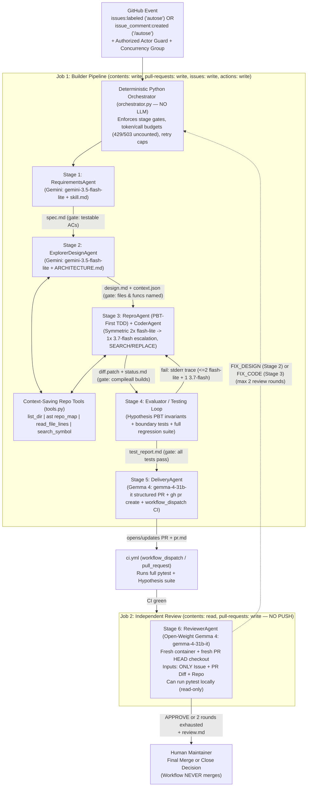

# Component View — Agentic SDLC Workflow

## High-Level Architecture

The workflow runs on GitHub Actions (`.github/workflows/autose.yml`) and is split across **two isolated GitHub Actions jobs** per review round to enforce least-privilege security and strict cross-family reviewer independence:

1. **Builder Pipeline Job (`round1_build` / `round2_build`)** — Runs Stages 1–5 via a **zero-LLM deterministic Python orchestrator** (`workflow/agents/orchestrator.py`) with permissions `contents: write`, `pull-requests: write`, `issues: write`, `actions: write`. Stages 1–4 use **Gemini 3.x** (`gemini-3.5-flash-lite` primary → `gemini-3.7-flash` escalation, with `429`/`503` uncounted fallback); Stage 5 offloads PR summarization to open-weight **Gemma 4** (`gemma-4-31b-it`).
2. **Independent Review Job (`round1_review` / `round2_review`)** — Runs Stage 6 in a **fresh GitHub Actions runner container** with **read-only code permissions** (`contents: read`, `pull-requests: write`, `issues: read` — **cannot push**), a fresh checkout of PR HEAD, zero access to Stage 1–5 traces, and a distinct open-weight model family (**Gemma 4 `gemma-4-31b-it`**, fallback `gemma-4-26b-a4b-it`).

---

## Component Responsibilities & Boundaries

| Component | File(s) | Model / Provider & Permissions | Outputs |
|---|---|---|---|
| **Orchestrator** | `workflow/agents/orchestrator.py` | **Deterministic Python (No LLM)**; enforces gates, caps, path allowlist | Stage routing & exit codes |
| **LLM Gateway** | `workflow/agents/llm.py` | `google-genai` (`GEMINI_API_KEY`); pacing, 429/503 uncounted backoff + fallback chains, token & call caps | `usage.json` |
| **Repo Context Tools** | `workflow/agents/tools.py` | Read-only Python `ast` `repo_map`, `list_dir`, `read_file_lines`, `search_symbol` + `SEARCH/REPLACE` patcher | Minimal slices (prevents context bloat) |
| **Stage 1: RequirementsAgent** | `workflow/agents/stage1_requirements.py` | Gemini `gemini-3.5-flash-lite`; reads sanitized issue JSON + `skill.md` | `spec.md` |
| **Stage 2: ExplorerDesignAgent** | `workflow/agents/stage2_design.py` | Gemini `gemini-3.5-flash-lite`; reads `spec.md`, `ARCHITECTURE.md`, `tools.py` | `design.md`, `context.json` |
| **Stage 3: Repro + CoderAgent** | `workflow/agents/stage3_implement.py` | Symmetric loop: `gemini-3.5-flash-lite` (×2) → `gemini-3.7-flash` (×1); PBT-first repro + `SEARCH/REPLACE` on `autose/issue-<N>` | `diff.patch`, `status.md` |
| **Stage 4: Evaluator / Testing** | `workflow/agents/stage4_test.py` | Deterministic `pytest` + `hypothesis` (PBT-first invariants + boundary tests + regression) & feedback loop to CoderAgent | `test_report.md` |
| **Stage 5: DeliveryAgent** | `workflow/agents/stage5_release.py` | Open-weight Gemma 4 `gemma-4-31b-it` + `git`/`gh` (`--event workflow_dispatch` CI verification) | `pr.md`, PR link |
| **Stage 6: ReviewerAgent** | `workflow/agents/stage6_review.py` | **Isolated Job 2:** Open-weight Gemma 4 `gemma-4-31b-it` (`contents: read`, NO push); sees ONLY Issue + PR diff + repo | `review.md`, verdict |
