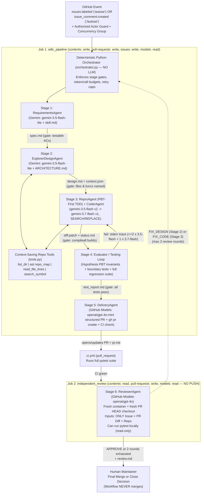

# Component View — Agentic SDLC Workflow

## High-Level Architecture

The workflow runs on GitHub Actions (`.github/workflows/autose.yml`) and is split across **two isolated GitHub Actions jobs** per review round to enforce least-privilege security and strict cross-provider reviewer independence:

1. **Builder Pipeline Job (`sdlc_pipeline`)** — Runs Stages 1–5 via a **zero-LLM deterministic Python orchestrator** (`workflow/agents/orchestrator.py`) with permissions `contents: write`, `pull-requests: write`, `issues: write`, `models: read`. Stages 1–2 use **`gemini-3.5-flash-lite`**, Stages 3–4 use **`gemini-3.5-flash`** (×2) → **`gemini-3.7-flash`** (×1 escalation, with `gemini-3.6-flash` / `gemma-4-31b-it` fallback), and Stage 5 offloads PR summarization to **GitHub Models** (`openai/gpt-4o-mini`).
2. **Independent Review Job (`independent_review`)** — Runs Stage 6 in a **fresh GitHub Actions runner container** with **read-only code permissions** (`contents: read`, `pull-requests: write`, `issues: read`, `models: read` — **cannot push**), a fresh checkout of PR HEAD, zero access to Stage 1–5 traces, and a completely different LLM provider (**GitHub Models `openai/gpt-4o`**).

---

## Component Responsibilities & Boundaries

| Component | File(s) | Model / Provider & Permissions | Outputs |
|---|---|---|---|
| **Orchestrator** | `workflow/agents/orchestrator.py` | **Deterministic Python (No LLM)**; enforces gates, caps, path allowlist | Stage routing & exit codes |
| **Multi-Provider LLM Gateway** | `workflow/agents/llm.py` | `google-genai` (`GEMINI_API_KEY`) + GitHub Models REST (`GITHUB_TOKEN`); pacing, 429 backoff, token & call caps | `usage.json` |
| **Repo Context Tools** | `workflow/agents/tools.py` | Read-only Python `ast` `repo_map`, `list_dir`, `read_file_lines`, `search_symbol` + `SEARCH/REPLACE` patcher | Minimal slices (prevents context bloat) |
| **Stage 1: RequirementsAgent** | `workflow/agents/stage1_requirements.py` | Gemini `gemini-3.5-flash-lite`; reads sanitized issue JSON + `skill.md` | `spec.md` |
| **Stage 2: ExplorerDesignAgent** | `workflow/agents/stage2_design.py` | Gemini `gemini-3.5-flash-lite`; reads `spec.md`, `ARCHITECTURE.md`, `tools.py` | `design.md`, `context.json` |
| **Stage 3: Repro + CoderAgent** | `workflow/agents/stage3_implement.py` | Gemini `gemini-3.5-flash` (×2) → `gemini-3.7-flash` (×1, fallback `3.6-flash`/`gemma-4-31b-it`); TDD repro + `SEARCH/REPLACE` on `autose/issue-<N>` | `diff.patch`, `status.md` |
| **Stage 4: Evaluator / Testing** | `workflow/agents/stage4_test.py` | Deterministic `pytest` + `hypothesis` (PBT-first invariants + boundary tests + regression) & feedback loop to CoderAgent | `test_report.md` |
| **Stage 5: DeliveryAgent** | `workflow/agents/stage5_release.py` | GitHub Models `openai/gpt-4o-mini` (`models: read`) + `git`/`gh` | `pr.md`, PR link |
| **Stage 6: ReviewerAgent** | `workflow/agents/stage6_review.py` | **Isolated Job 2:** GitHub Models `openai/gpt-4o` (`contents: read`, `models: read`, NO push); sees ONLY Issue + PR diff + repo | `review.md`, verdict |
